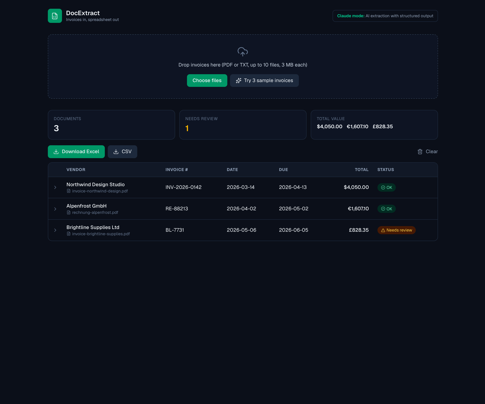

# DocExtract: Invoice Data Extraction to Excel

Upload invoices (PDF or TXT), extract the key fields automatically, check the math, and download a clean Excel file. Built with **Next.js (App Router)**, **TypeScript**, **Tailwind CSS**, and the **Anthropic Claude API** (structured outputs).

**Live demo:** [ai-invoice-data-extractor.vercel.app](https://ai-invoice-data-extractor.vercel.app)



> **Demo note:** the app runs without any API key in **demo mode**, using rule-based extraction (pattern matching, no AI) that handles common invoice layouts. Add an `ANTHROPIC_API_KEY` and extraction is done by Claude with schema-enforced JSON output, which also handles unusual layouts and languages.

## What it does

1. **Upload** up to 10 invoices at once (drag and drop). Three sample invoices are built in: different vendors, currencies (USD, EUR, GBP), number formats (`$2,400.00`, `1.140,00 EUR`), and date formats.
2. **Extract** vendor, invoice number, invoice and due dates, currency, subtotal, tax, total, and every line item.
3. **Validate** automatically. Each invoice is cross-checked: quantity × unit price per line, line items against the subtotal, and subtotal + tax against the total. Anything that does not add up is flagged **Needs review** with the exact reason. In the sample set, one invoice has a deliberate error in its total, and the app catches it.
4. **Export** to Excel (two sheets: Invoices and Line items, review rows highlighted) or CSV.

## Why validation matters

Language models and parsers can misread a document. Instead of trusting extraction blindly, DocExtract treats the output as untrusted and verifies it arithmetically, so a human only needs to look at the invoices that fail a check.

## Tech Stack

Next.js · React · TypeScript · Tailwind CSS · `@anthropic-ai/sdk` (structured outputs with Zod) · `unpdf` (PDF text) · `exceljs` · Lucide icons

## Project Structure

```text
src/
├── app/api/
│   ├── extract/route.ts     # Upload, text extraction, AI or rule-based extraction, validation
│   ├── export/route.ts      # Excel workbook generation
│   └── status/route.ts      # Reports whether an API key is configured
├── components/ExtractApp.tsx
└── lib/
    ├── schema.ts            # Zod schema shared by the model output and the UI
    ├── claudeExtract.ts     # Claude call with schema-enforced JSON output
    ├── ruleExtract.ts       # Demo-mode pattern matching (dates, EU/US numbers, line items)
    ├── validate.ts          # Arithmetic cross-checks
    └── rateLimit.ts         # In-memory rate limiter
public/samples/              # Fictional sample invoices (PDF)
```

## Getting Started

```bash
git clone https://github.com/SeriDaron/ai-invoice-data-extractor.git
cd ai-invoice-data-extractor
npm install
cp .env.example .env.local   # optional: add your ANTHROPIC_API_KEY
npm run dev
```

Open [http://localhost:3000](http://localhost:3000) and click **Try 3 sample invoices**.

## Design decisions and limitations

- **Text-based PDFs only.** Scanned invoices need OCR first; the app reports when no text can be extracted.
- **Stateless:** nothing is stored on the server. Files are processed in memory and results live in the browser.
- **Demo-mode extraction is rule-based** and tuned for common layouts. For arbitrary layouts use Claude mode.
- **Limits:** 10 files per batch, 3 MB per file, in-memory rate limiting. Use Redis or an edge limiter in production.
- **Public deployments:** if you deploy with a real API key, set spending limits on the key.

## Extending it

- OCR for scanned documents
- Direct export to accounting tools (QuickBooks, Xero) or Google Sheets
- Human-in-the-loop editing of flagged fields
- Batch processing through a queue for large volumes

## Need something similar?

I build document-processing pipelines, data extraction tools, and AI integrations. Feel free to reach out.
